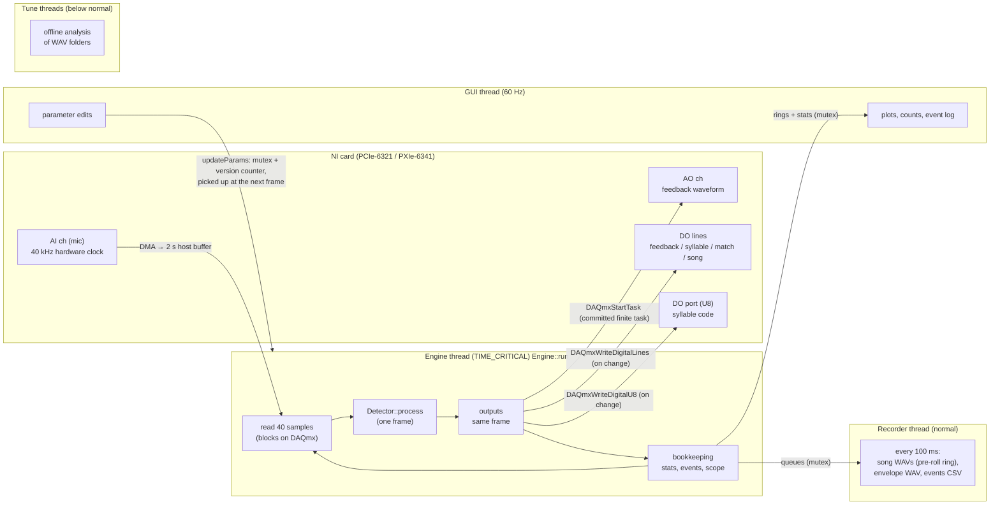

# Live engine: how detection and feedback run

This describes what happens while **Live** acquisition is running: which threads exist, what one
1 ms frame does, and where each output is decided and written. File references point at the code.

## Structure: boxes, frame sources, engine

```
 Engine (src/app/Engine.cpp)            owns the boxes and one acquisition thread per FrameSource
  ├─ FrameSource (src/io/FrameSource.h) where frames come from, where each box's outputs go
  │    ├─ SingleSource                  one box on its own backend (single-box modes, simulated boxes):
  │    │                                DaqBackend = committed finite AO (sub-ms), pulse input, noise burst
  │    └─ DaqCard (src/io/DaqCard.cpp)  multi-box: every box whose mic is on one NI card:
  │                                     1 AI task (a channel per box), 1 DO task (all boxes' TTL lines),
  │                                     a code-port task per box, 1 streaming AO task (a channel per box)
  └─ Box (src/app/Box.cpp)              one box: Detector, decisions, outputs, counters, recorder,
                                        plot buffers, event log, stats; process() runs one frame
```

Single-box modes run one Box on one SingleSource; multi-box groups DAQ boxes into one DaqCard per card
(simulated boxes each get a SingleSource). Every Box runs the same `process()`, so detection and decisions
are identical in every mode. The diagram and frame walk-through below show one box; on a DaqCard the thread
reads one frame for all its boxes, runs `process()` for each, then writes the card's combined DO and AO
once (`endFrame`).

### Multi-box AO stream

```
 AI sample clock (/DevN/ai/SampleClock) ──clocks──► AO stream task (ao0 = box A, ao1 = box B)

 every frame:  read n AI samples per box → each Box decides → fire? sets that box's playback cursor
               → write n AO samples per channel (box's stimulus, or 0) → stream stays prefill frames ahead
```

The stream is primed with **AO stream buffer** ms of zeros and advances with the AI clock, so exactly one
frame is written per frame read and the output latency stays at the prefill. A stall longer than the
prefill underflows the stream: the error is logged on the card's boxes and the stream is re-primed and
restarted (at most once a second).

## Threads



Only the engine thread touches the DAQ tasks while running. The GUI never blocks it for more than a
short copy: parameter changes are handed over with a version counter, and plots read snapshots of
ring buffers. Disk writes happen on the recorder thread, never on the engine thread.

## One frame (40 samples = 1 ms at 40 kHz)

```
 DAQmxReadAnalogF64(40)                                       src/io/DaqBackend.cpp  read()
        │
        ▼
 new params?  ── yes ──► Detector::setParams (hardware settings stay fixed for the run)
        │
        ▼
 Detector::process(x[40])                                     src/core/Detector.cpp
  │
  ├─► 15 ms ring buffer (600 samples, written twice so the window is contiguous)
  │      │
  │      ▼
  │   BandEnvelope::compute                                  src/core/BandEnvelope.cpp
  │      mean-subtract → × software gain → Hann window
  │      → Goertzel on only the bins inside enabled bands (~105 bins)
  │      → band RMS = sqrt(Σ bin power / ENBW) × band gain
  │      → value = Σ include − Σ subtract   (or Sum / Ratio / Include only)
  │      → low cutoff
  │
  ├─► SongDetector::process                                  src/core/SongDetector.cpp
  │      × gain + offset → (Butterworth bandpass) → 2048-sample ring
  │      every 5 ms: Hann + FFT → ratio = mean bird-band power / mean non-bird power
  │      above = ratio > Ratio Thresh;  fraction = share of last 0.5 s above
  │      song active = fraction > Duration Thresh (+ hold)
  │
  └─► Detector::decide(value, song)
         │
         ├─ SyllableSegmenter        value > start → ONSET (IOI = onset − previous onset)
         │                           value < end   → OFFSET (SD = offset − onset)
         │                                                   src/core/Syllables.cpp
         ├─ SyllableClassifier       at each IOI end (= onset): walk the syllable list,
         │                           first syllable whose windows contain
         │                           (IOI, SD of previous syllable, previous IOI) wins
         │                           → index, U8 code      src/core/SyllableCodes.cpp
         │
         ├─ target match             index == Feedback target
         ├─ song gate                blocked if gating is on and no song
         │
         └─ FeedbackStateMachine     rising edge → probability draw → Triggered (arm wave)
                                     → Delay (n frames) → Sending (amplitude check) → fire
                                     → Refractory → Listening
                                                     src/core/FeedbackStateMachine.cpp
        │
        ▼
 Outputs, in the same frame                                   src/app/Engine.cpp  run()
   arm   → DAQmxWriteAnalogF64 into the committed AO task (only if a different wave)
   fire  → DAQmxStartTask(AO)          + feedback TTL high for "TTL pulse" ms
   match → match TTL high for "TTL pulse" ms
   syllable TTL = in syllable;  song TTL = song active      (one DAQmx write, only on change)
   code port   = matched code at the IOI end, then 0 per Hold mode   (only on change)
        │
        ▼
 Bookkeeping: processing time, backlog (samples waiting in the DAQmx buffer), counters,
 events → GUI log + recorder queue, raw/envelope → recorder queue, scope rings for plots
```

## Timing of a feedback event

```
 syllable C starts  ─┐
                     │  envelope rises as C fills the 15 ms window
                     ▼
 frame k:  value > start threshold  → ONSET, IOI ends → classified as target
           → state machine: Triggered → arms the AO wave → Delay
 frame k+D (D = Delay + Feedback Delay, in 1 ms frames):
           → Sending: envelope ≥ Detect Signal Thresh? → DAQmxStartTask(AO) + feedback TTL
```

* Detection latency (true onset → ONSET frame) is the time the envelope takes to cross the start
  threshold, typically 1–3 ms for loud syllables, plus at most one frame (1 ms).
* The decision and the outputs happen in the same frame. LabVIEW spent one loop iteration per
  state, so this is a few ms faster for the same settings.
* Measured on this PC (simulated source): about 60–90 µs of processing per 1 ms frame on average,
  with occasional peaks of 0.3–0.9 ms from OS scheduling. The DAQmx buffer absorbs these (the
  status bar shows the backlog).

## What runs where (summary)

| Thread | Priority | Does | Must never |
|---|---|---|---|
| Engine | TIME_CRITICAL | read AI, detect, decide, write AO/DO/port, queue logs | touch the disk, wait on the GUI |
| Recorder | normal | keep the pre-roll ring, open/extend/close song WAVs, write the events CSV, every 100 ms | — |
| GUI | normal | draw at 60 Hz, push parameter edits | hold the shared mutex for long |
| Tune | below normal | offline analysis of recordings | compete with the engine |
